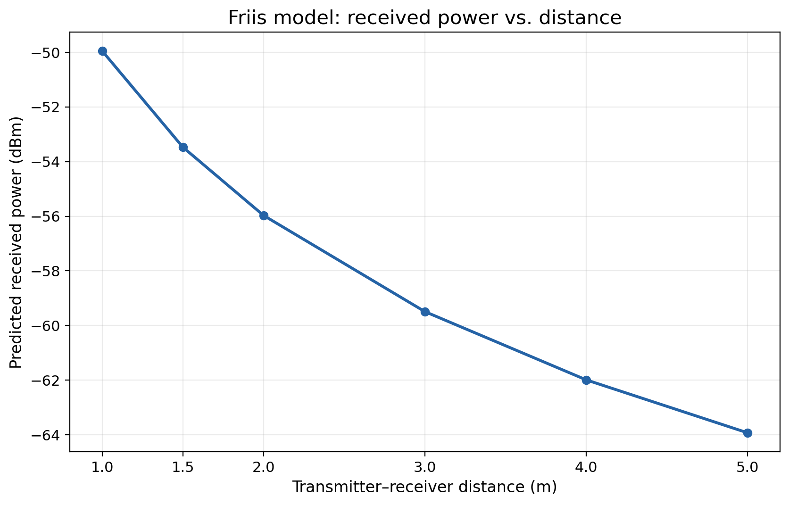
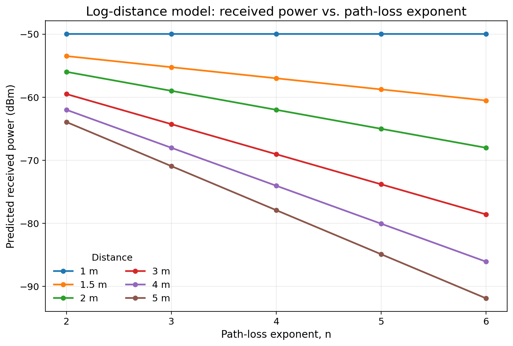
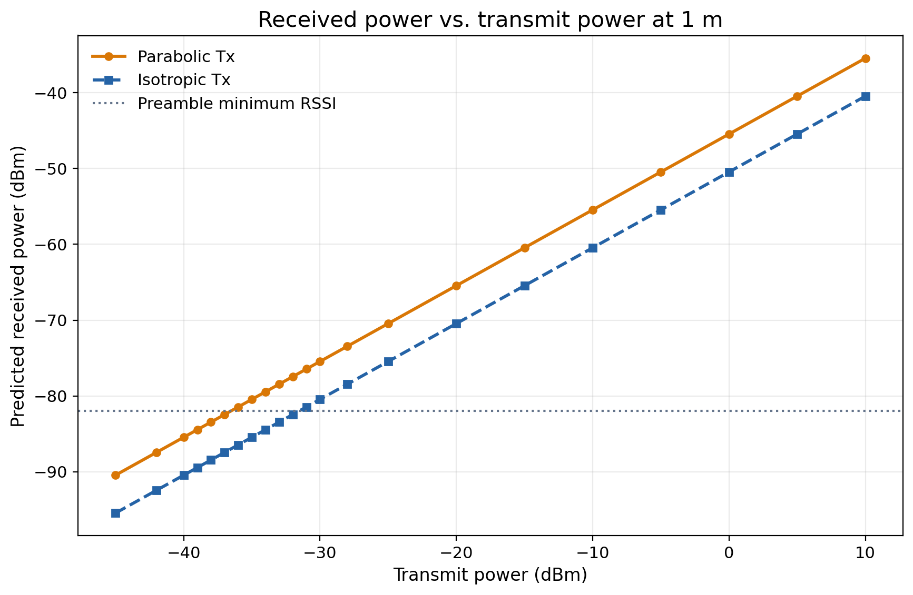
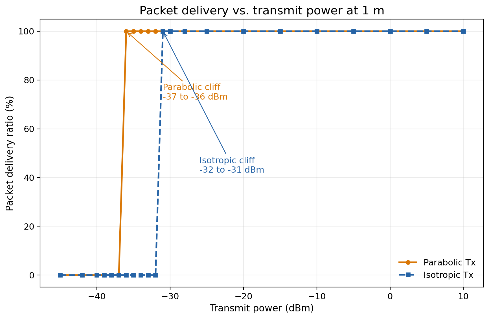

# Capstone ns-3 simulation

This directory contains the capstone project's ns-3 simulation code.

## Install in ns-3

This repository is designed to live at `scratch/capstone` inside an ns-3.47
source tree. Clone it directly into that location:

```bash
cd /path/to/ns-3.47
git clone https://github.com/spudMelf/ns3-cryogenic-channel-capstone.git scratch/capstone
```

The simulations require the standard ns-3 applications, antenna, core,
flow-monitor, internet, mobility, network, propagation, spectrum, and Wi-Fi
modules. The plotting script requires Python with pandas and matplotlib.

## Simulations

The project currently has two matched channel-model simulations:

- `capstone-friis.cc` is the ideal free-space baseline.
- `capstone-log-distance.cc` is the adjustable log-distance baseline.

Both use the same fixed 7.5 GHz carrier, 1 m distance, radio abstraction,
traffic, timing, and metrics. Only the propagation-loss model differs.

From the ns-3 root directory, run the Friis simulation with:

```bash
./ns3 run capstone-friis
```

Run the log-distance simulation with:

```bash
./ns3 run capstone-log-distance
```

Run the matched 5 m transmit-power sweeps with:

```bash
./ns3 run capstone-tx-power-sweep
```

Run the best-current one-meter cryostat-window setup with:

```bash
./ns3 run capstone-experimental-setup
```

Run the native ns-3 antenna-pattern comparison with:

```bash
./ns3 run capstone-antenna-model-comparison
```

Regenerate all plots after running the simulations with:

```bash
python3 scratch/capstone/plot-results.py
```

## Key plots

### Friis received power versus distance



### Log-distance received power versus path-loss exponent



### Antenna comparison at one metre





## Model notes

The experiments use fixed values declared near the beginning of each source
file. Keep the shared settings identical when updating them so the comparison
isolates the propagation model.

Results are written separately to `results/friis-results.csv` and
`results/log-distance-results.csv`. Each program rebuilds its complete sweep
file on every execution. The current sweep uses distances of 1, 1.5, 2, 3, 4,
and 5 m. The log-distance sweep repeats those distances for exponents n=2, 3,
4, 5, and 6. The transmit-power experiment holds distance at 5 m and sweeps
from -20 to +10 dBm in 5 dB steps for Friis and log-distance n=4.

The experimental-setup comparison uses aligned 5 dBi patch antennas, a 50 K
transmitter environment, a 290 K external receiver and noise environment, and
a separately recorded 0.5 dB provisional window insertion loss. It compares
Friis against log-distance n=2 at 1 m. Replace the provisional window loss and
antenna gains with measured values when the hardware is characterized.

The antenna comparison uses `SpectrumWifiPhy` so ns-3 applies its native
`IsotropicAntennaModel`, `CosineAntennaModel`, `ParabolicAntennaModel`, and
`ThreeGppAntennaModel` patterns to packet reception. All four cases are
normalized to 5 dBi at boresight and use the same 1 m Friis-plus-window link.
It sweeps equal transmitter and receiver yaw errors from 0 to 90 degrees.
The cosine and parabolic comparison beamwidth is provisionally 90 degrees;
replace it with the measured patch beamwidth when available.

The same program also sweeps transmit power from -20 to +10 dBm for all four
antenna models at perfect boresight alignment and at a symmetric 60-degree yaw
error. These rows are stored separately in
`results/antenna-model-tx-power-results.csv` so they do not mix with the
pointing-error sweep.

It also records a dedicated mixed-antenna link with a 5 dBi parabolic
transmitter at boresight and a 0 dBi isotropic receiver. That result is stored
in `results/parabolic-tx-isotropic-rx-results.csv`. The link retains the 7.5
GHz carrier, 1 m distance, Friis propagation, and separate provisional 0.5 dB
window insertion loss used by the experimental setup.

The program also compares that boresight-aligned 5 dBi parabolic transmitter
against a 0 dBi isotropic transmitter while holding the Friis link at the
room-scale 1 m baseline and sweeping transmit power from -45 to +10 dBm. The
receiver remains isotropic in both cases. The complete data are stored in
`results/parabolic-vs-isotropic-tx-power-results.csv`. Received power and
packet delivery are graphed separately in
`results/plots/parabolic-vs-isotropic-tx-power-received-power.png` and
`results/plots/parabolic-vs-isotropic-tx-power-pdr.png`.

The packet link cliff is governed here by the explicitly recorded ns-3
`ThresholdPreambleDetectionModel` settings: -82 dBm minimum RSSI and 4 dB
minimum SNR. These are receiver-model assumptions, not outputs of Friis.

An additional boresight `TwoRayGroundPropagationLossModel` row is recorded for
each antenna as a reflection sensitivity check. It is not a cryostat-wall or
window-reflection model. At the current 1 m geometry it uses its short-range
Friis branch, so matching results are expected and should not be interpreted
as evidence that reflections are absent.

Shared simulation and output logic lives in `capstone-simulation-common.h` so
the Friis and log-distance experiments use identical radio, traffic, noise,
receiver, and metric calculations.

Use `data/` for input measurements and `results/` for generated output. The
current result tables and plots are committed so the reported findings can be
reviewed without rerunning ns-3.
